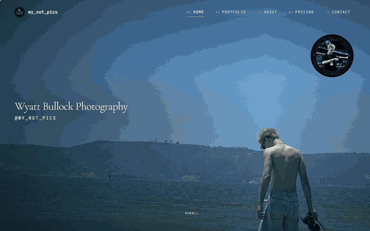
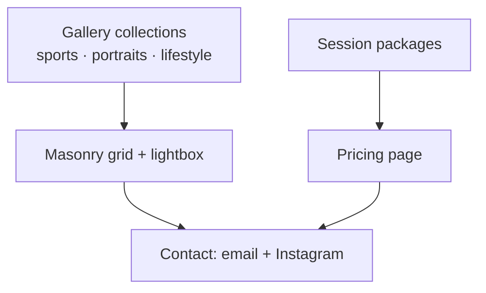
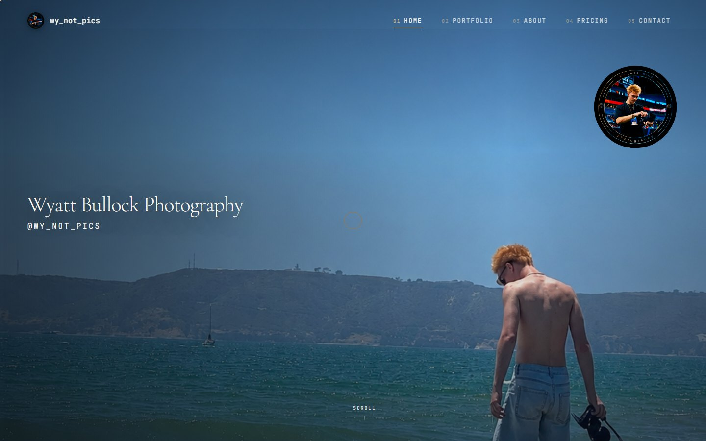
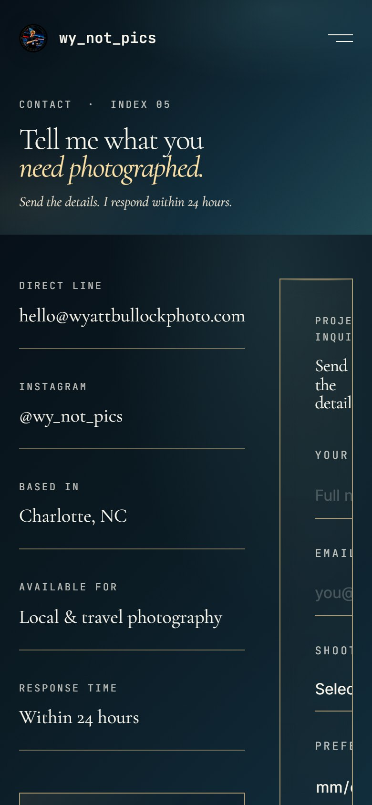
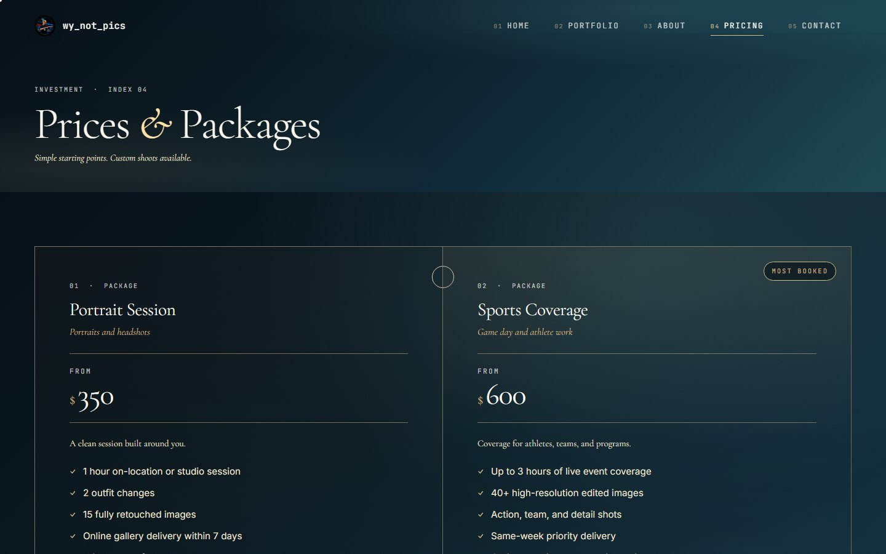

  

<h1 align="center">wy_not_pics</h1>

<strong>A portfolio website for Charlotte photographer Wyatt Bullock: sports, portraits, and lifestyle work moved off a social feed and into a site that reads as a brand.</strong>

  &nbsp;
  &nbsp;
  

Live · Client project for Wyatt Bullock (@wy_not_pics) · Designed and built by Davis Higgins

---

## See it in motion

  

Real capture of the live site's booking path: home, pricing, contact. <a href="assets/demo.png">Static frame</a>

## What it does

- **The work, in its own frame.** Portfolio sections for sports, portraits, and lifestyle use a masonry grid that keeps each photo's own shape, with a full-screen lightbox, instead of square feed crops.
- **Clear starting points.** A pricing page lays out session packages (portraits, sports coverage, lifestyle and brand, custom) so a prospective client knows where to begin.
- **A direct line.** Every page leads to contact: direct email and the Instagram handle the brand grew from.

## The brief

Wyatt's photography was strong, but its presentation lived in a social feed: a grid of square crops in someone else's interface, with no simple way to book a shoot. The site needed to put the photographs first, keep everything else quiet, and turn interest into an inquiry. It also needed to belong to Wyatt rather than to a platform.

## What I built

- The site's structure: home, portfolio with sports, portraits, and lifestyle sections, about, pricing, and contact
- An editorial visual system: deep ink-blue surfaces, ivory text, cyan and amber accents, Cormorant Garamond with Inter and JetBrains Mono, and a film-grain texture
- The masonry gallery and lightbox, portfolio sub-tabs, a custom cursor, and page transitions
- Easy-to-update galleries and pricing, so new work or new packages never require a redesign

<strong>How it's put together</strong>

 

| Decision | Why |
|---|---|
| **Every photo keeps its composition** | Portrait and landscape frames are laid out at their real proportions instead of being cropped to squares. |
| **A real page for every collection** | Each portfolio section has its own address, and older links keep working. |
| **Updates without redesigns** | New shoots and new packages drop into place without touching the layout. |

## Screens

<table>
  <tr>
    <td width="62%"></td>
    <td rowspan="2" width="38%" align="center"></td>
  </tr>
  <tr>
    <td></td>
  </tr>
</table>

Homepage · Pricing · Contact on mobile

## Technology

| Layer | Technology |
|---|---|
| App | React, Vite |
| Motion | Framer Motion |
| Styling | CSS |
| Hosting | Vercel |

---

  &nbsp;
  

© 2026 Davis Higgins. The wy_not_pics name, badge, and all photographs belong to Wyatt Bullock.

