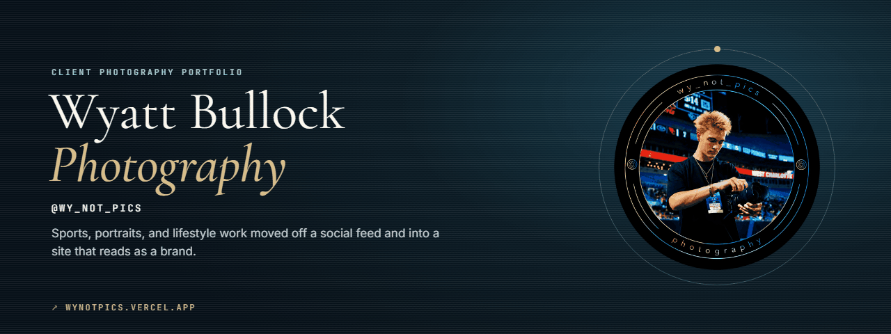
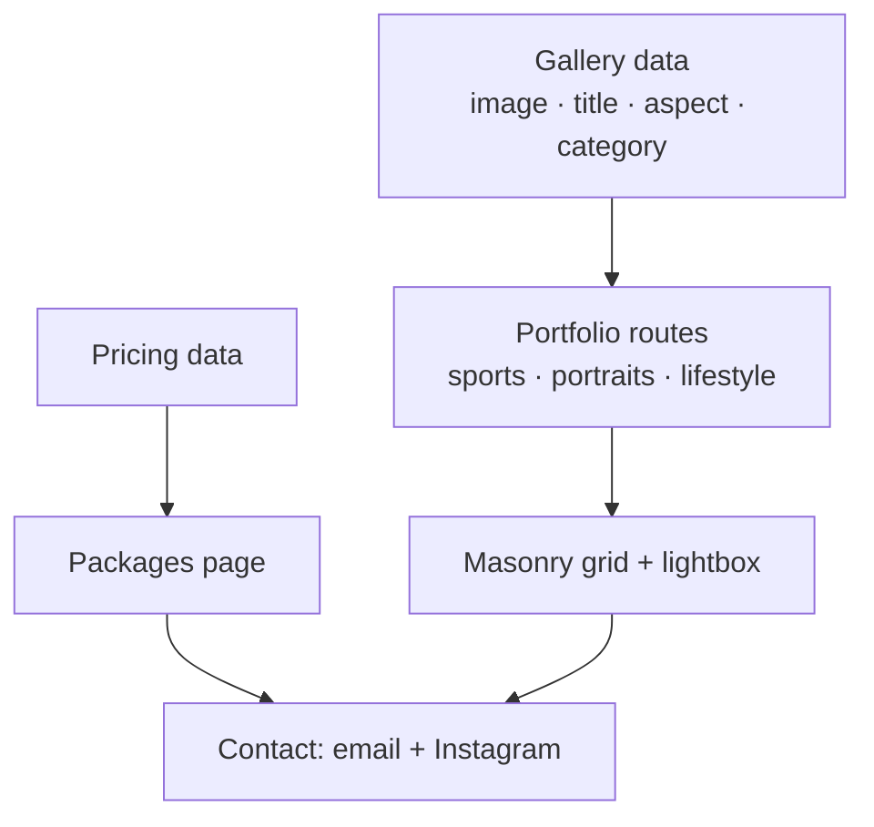

  

<h1 align="center">wy_not_pics</h1>

  <strong>A portfolio website for Charlotte photographer Wyatt Bullock: sports, portraits, and lifestyle work moved off a social feed and into a site that reads as a brand.</strong> 
  <a href="https://wynotpics.vercel.app"><strong>Visit the site ↗</strong></a> · <a href="https://www.higginsd.com/work/wy-not-pics">Case study</a> · <a href="https://davishiggins.com">Davis Higgins</a>

Live · Client project for Wyatt Bullock (@wy_not_pics) · Designed and built by Davis Higgins · Separate from the Y NOT? apparel brand

---

## See it in motion

  

Real capture of the live site's booking path: home, pricing, contact. Gallery pages aren't recorded here because they show Wyatt's clients. <a href="assets/demo.png">Static frame</a>

## What it does

- **The work, in its own frame.** Portfolio sections for sports, portraits, and lifestyle use a masonry grid at each photo's own aspect ratio, with a lightbox, instead of square feed crops.
- **Clear starting points.** A pricing page lays out session packages (portraits, sports coverage, lifestyle and brand, custom) so a prospective client knows where to begin.
- **A direct line.** Every page leads to contact: a direct email address and the Instagram handle the brand grew from.

## The brief

Wyatt's photography was strong, but its presentation lived in a social feed: a grid of square crops in someone else's interface, with no simple way to book a shoot. The site needed to put the photographs first, keep everything else quiet, and turn interest into an inquiry. It also needed to belong to Wyatt rather than to a platform.

## What I built

- The site's structure: home, portfolio with sports, portraits, and lifestyle sections, about, pricing, and contact
- An editorial visual system: deep ink-blue surfaces, ivory text, cyan and amber accents, Cormorant Garamond with Inter and JetBrains Mono, and a film-grain texture
- The masonry gallery and lightbox, portfolio sub-tabs, a custom cursor, and page transitions
- Data files for gallery images and pricing, so new work or new packages are a data edit

## How it's put together

### Engineering decisions

| Decision | Why |
|---|---|
| **Aspect ratio comes from the data** | Each image records its own orientation, and the masonry grid lays out around it. Portrait and landscape frames keep their composition instead of being cropped to squares. |
| **Real routes for each collection** | Every portfolio section has its own URL, and old paths like `/gallery/*`, `/events`, and `/nature` redirect to their new homes, so shared links keep working. |
| **Content in data files** | Gallery images and pricing packages are plain data. Updating a package or adding a shoot doesn't mean touching page code. |

## Screens

<table>
  <tr>
    <td width="62%"></td>
    <td rowspan="2" width="38%" align="center"></td>
  </tr>
  <tr>
    <td></td>
  </tr>
</table>

Homepage · Pricing · Contact on mobile

## Technology

| Layer | Technology | Responsibility |
|---|---|---|
| App | React 18, Vite, React Router | Routes for every collection and page |
| Motion | Framer Motion | Page transitions and scroll reveals |
| Styling | Plain CSS with custom properties | Design tokens, grain, editorial layout |
| Hosting | Vercel | Deployment |

## Status

- **Live** at wynotpics.vercel.app.
- **Inquiries go by email and Instagram.** The contact page also has a project form, but it isn't connected to a delivery service yet, so the email address and Instagram are the working ways to book.
- **Photography rights.** All photographs belong to Wyatt Bullock. This showcase includes only images of Wyatt from his own site and doesn't republish client photos.

## About this repository

This is a documentation-only showcase. The site's source and photo library aren't included here.

**[Visit the site ↗](https://wynotpics.vercel.app)** · Built by [Davis Higgins](https://davishiggins.com) · [More of my work](https://github.com/DavisHiggins)

© 2026 Davis Higgins. Screenshots are shared for portfolio viewing. The wy_not_pics name, badge, and all photographs belong to Wyatt Bullock.
